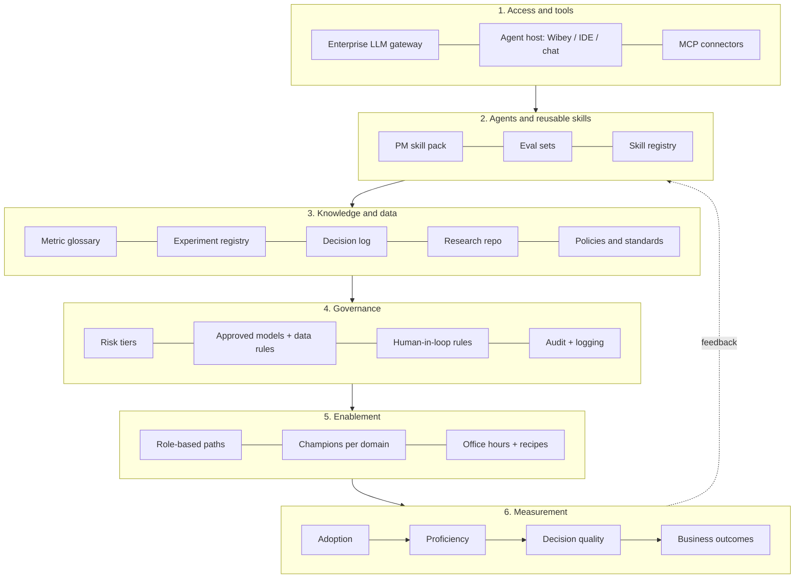

# 2. Ecosystem and operating model

Goal: move PMs from little or no AI use to effective, responsible adoption. Tools alone do not do this. The ecosystem has six layers and an operating model that keeps them alive.

## Layer detail

### 1. Access and tools
- Approved model access through an enterprise gateway (SSO, spend limits, logging, data-handling guarantees). Default path must be the easy path, or shadow AI wins.
- One or two blessed agent hosts, not twelve. Assumption: Wibey is the agent host, with the internal gateway behind it.
- MCP connectors for the systems PMs already live in (Jira, Confluence, GitHub, SharePoint/Outlook, internal search). Read-only first. See `10-mcp-and-plugin-catalog.md`.

### 2. Agents and reusable skills (the PM skill pack)
| Skill | Job it does | Decision it improves | Risk tier |
|---|---|---|---|
| **Decision Readiness Reviewer** (built here) | Grounded pre-review of a proposal | Quality of what reaches human review | Amber |
| Metric lookup and definition checker | Canonical definition, owner, caveats | Fewer metric disputes | Green/Amber |
| Prior-art finder | Related experiments, decisions, research | Avoids repeating failures | Amber |
| Experiment design assistant | Unit, duration, MDE, interference guidance | Valid tests | Amber |
| VoC and ticket synthesizer | Themes from support, driver, customer feedback | Problem selection | Red if raw PII |
| Launch readiness checklist | Cross-functional gate check | Fewer launch surprises | Amber |
| Weekly business review narrator | Draft narrative from approved metrics | Time, not decision quality (lowest priority) | Amber |

Skills are versioned markdown plus code in a registry with an owner, an eval set, a risk tier, and a changelog. Promotion path: **sandbox -> team pilot -> registry (requires eval pass + risk review)**.

### 3. Knowledge and data (the part that decides whether anything works)
Generic models fail at enterprise work because the model has never seen your definitions, history, or constraints. The binding asset is **curated, owned, fresh context**:
- **Metric glossary**: one canonical definition per metric, with owner and aliases.
- **Experiment registry**: hypothesis, design, result, learning, status.
- **Decision log**: what was decided, why, who, and when to revisit.
- **Policies and standards**: guardrail rules, review triggers, experimentation standards.
- **Research repository**: tagged, access-controlled.

Every chunk carries `owner`, `last_reviewed`, `sensitivity`. Stale or ownerless knowledge is flagged to users and to owners. ACLs pass through from source systems so the agent never reveals what the PM could not already read.

### 4. Governance
- **Risk tiers**: Green (public or non-sensitive, no review), Amber (internal, advisory output, log it), Red (customer or driver personal data, pay, safety, regulated decisions: approved models only, named human approver, full audit).
- **Human-in-the-loop rules** by tier: AI may draft and flag; it may never approve, send externally, or change a system of record without a human action.
- **Approved models and data rules** published in one page a PM can read in two minutes.
- **Fast lane**: a lightweight intake and a 5-business-day SLA for new skills. Slow governance creates shadow AI.
- **Audit**: inputs, retrieved sources, outputs, and human overrides are logged for Amber and Red skills.

### 5. Enablement
- **Role-based paths**, not generic prompt training: "Use AI to review a PRD", "Use AI to design an experiment", each 45 minutes on a real artifact.
- **Champions network**: one per domain (for example LMD, Fulfillment, Marketplace), about 10 percent of their time, own the domain's knowledge base quality and local recipes.
- **Office hours and recipes**: weekly office hours; a library of tested recipes; failure stories shared as readily as wins.
- **Manager enablement**: managers need to review AI-assisted work and set the expectation that verification is non-negotiable.

### 6. Measurement
Four tiers, each answering a different question:

| Tier | Question | Example metrics | Danger |
|---|---|---|---|
| Adoption | Are people using it? | Weekly active PMs by workflow; % of proposals run through the reviewer | Vanity if alone |
| Proficiency | Are they good at it? | Verification rate (citations opened), override rate, maturity level self and manager rated | Self-report bias |
| Decision quality | Are decisions better? | First-pass review acceptance; send-backs per proposal; % proposals with baseline + guardrails; prior-art citation rate | Gaming (writing to pass) |
| Business outcomes | Did it matter? | Cycle time idea->decision; experiment validity rate; regretted launches; reviewer hours per launch | Attribution is hard; use cohorts and staggered rollout |

## Operating model

**Federated: central platform, domain-owned context.**

| Role | Owns | Does not own |
|---|---|---|
| AI Enablement (central, this PM's team) | Platform, skill registry, eval standards, training, measurement, vendor and gateway relationships | Domain knowledge accuracy |
| Domain champions (per org, e.g. LMD) | Domain knowledge base, local recipes, feedback loop | Platform |
| Knowledge owners (Analytics, Data Science, Policy Office) | Accuracy and freshness of their sources | Agent behavior |
| Governance council (Legal, Privacy, InfoSec, Responsible AI) | Risk tiers, approved models, red-tier approvals | Day-to-day skill intake (delegated via fast lane) |
| PMs | Decisions, verification, feedback | None of the above |

**Cadence**: weekly champion sync, monthly metrics review, quarterly skill-registry and policy review, and a standing "failure review" where misses from the evals and production are discussed without blame.

**Flywheel** (why this compounds): every proposal reviewed surfaces knowledge gaps (undefined metrics, missing experiment entries). Those gaps become tickets for knowledge owners. Better knowledge makes the reviewer better, which increases adoption, which exposes more gaps. The review agent is a **knowledge-quality sensor** as well as a user feature.

## What to stop or avoid
- Do not roll out seats first and hope. Seats without context, guardrails, and recipes produce L1 tourism.
- Do not build a generic "chat with all documents" assistant as the first product (see `03-problem-selection.md`).
- Do not mandate usage targets for their own sake.
