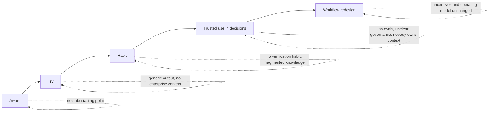

# 3. Which problem to solve first, and why

## 3.1 The adoption journey and where it breaks

| Stage | Observed friction (hypotheses to validate with PM interviews; marked assumption) | Typical fix |
|---|---|---|
| Aware -> Try | Unclear what is approved; fear of misuse (assumption) | Policy page, sandbox, access |
| Try -> Habit | Output is generic because the model has no LMD context; no recipe tied to a real PM task | Role-specific recipes |
| Habit -> Trusted | PMs cannot tell when to trust it; knowledge is scattered across Confluence, Jira, SharePoint, decks; reviewers see inconsistent quality | Grounding, citations, evals |
| Trusted -> Redesign | No owner for context quality; incentives reward output volume, not decision quality | Operating model |

**The pattern behind uneven adoption**: tools are available, but there is a *trust gap* (is this right? is this allowed?) and a *context gap* (it does not know our definitions, history, rules). Training and licenses do not close either gap.

## 3.2 Candidate problems considered

Scored 1-5 on six criteria (5 = best; for Risk, 5 = lowest risk). **These scores are my judgment, not data**; the sensitivity check below is how I tested whether the ranking is just my weights.

| Candidate | Impact on decision quality (30%) | Frequency (15%) | Breadth (10%) | Feasible in 2 weeks and evaluable (15%) | Strategic leverage / flywheel (20%) | Risk (10%) | **Weighted** |
|---|---|---|---|---|---|---|---|
| A. Tool access and licenses | 2 | 4 | 5 | 5 | 1 | 5 | 3.15 |
| B. Generic prompt training | 2 | 3 | 5 | 5 | 2 | 5 | 3.20 |
| C. Shared prompt library | 2 | 3 | 4 | 5 | 2 | 4 | 3.00 |
| D. "Chat with all our docs" assistant | 3 | 4 | 5 | 3 | 3 | 3 | 3.35 |
| E. "Can I use AI for this?" policy bot | 3 | 3 | 4 | 4 | 2 | 3 | 3.05 |
| **F. Grounded decision-readiness reviewer (chosen)** | 5 | 4 | 3 | 4 | 5 | 4 | **4.40** |
| G. Auto PRD / document writer | 2 | 5 | 5 | 5 | 2 | 3 | 3.30 |
| H. Adoption dashboard | 2 | 3 | 3 | 4 | 3 | 5 | 3.05 |
| I. VoC / ticket synthesis agent | 4 | 3 | 3 | 3 | 3 | 2 | 3.20 |

**Sensitivity**: with Impact cut to 15% and Feasibility raised to 30% (a "just ship something" bias), F scores 4.15 vs G 3.90 and D 3.45, so F still ranks first. Breadth is F's weak criterion (reviewing proposals applies to every PM, but at a lower frequency than writing). I would not claim F wins on every weighting, only that it wins on every weighting I considered reasonable.

## 3.3 Why F, in plain words

**The problem statement**: *Proposals reach scarce human reviewers (Data Science, Legal, Privacy, Ops) with preventable gaps: undefined metrics, missing guardrails, unreferenced prior experiments, missing policy reviews, weak experiment design. Reviewers catch some, late and inconsistently. Meanwhile PMs have no cheap way to test their own thinking against enterprise knowledge.*

Why this is the **hardest, highest-value** problem in the journey:

1. **It sits exactly on the trust gap and the context gap.** Solving it requires grounding in enterprise knowledge (context) and verifiable output (trust). Solve it and the same machinery serves every later skill.
2. **It improves decisions, not typing speed.** The unit of value is a better proposal reaching review, a prevented repeat experiment, an earlier policy flag.
3. **Review is a safer wedge than generation.** A review agent is advisory, it does not write the decision, and a miss is no worse than today's status quo (a human still reviews). A generation agent that is wrong silently injects errors into the artifact.
4. **It creates a flywheel and a sensor.** Every undefined metric or missing registry entry the agent hits is a knowledge-quality ticket for an owner. Adoption makes the knowledge base better, which makes the agent better.
5. **It is evaluable.** Flaws can be planted in synthetic proposals with known ground truth, and later replayed against real historical proposals with known outcomes. Most "AI for PMs" ideas cannot be evaluated this crisply.
6. **It converts governance into a product feature**: policy triggers and required reviews are surfaced at the moment of writing, so the compliant path is also the easy path.

## 3.4 Why not the alternatives (the honest counter-arguments)

| Alternative | Why not first | When it becomes right |
|---|---|---|
| **A. Licenses and access** | Necessary, not sufficient. Seats without context and recipes produce L1 tourism. Likely already in flight; low differentiation for a PM in this seat. | Already a precondition; treat as a dependency |
| **B. Prompt training** | Low retention and no grounding; the model still does not know our definitions. | As the wrapper that teaches *how to use* the skills, after they exist |
| **C. Prompt library** | Prompts rot, are personal, and carry no context or evals. A library without ownership becomes a graveyard. | Later, as a catalog of *evaluated skills*, not raw prompts |
| **D. Chat with all docs** | The most tempting option and the most common failure ("chat with your docs" has no task, so engagement decays, answers are plausible but unverified, and ACL leakage risk is high). It is infrastructure, not a product. | It is the **retrieval layer inside F**; build it for a task first |
| **E. Policy Q&A bot** | Valuable but narrow; policy answers have the highest cost of being wrong; reviewers will not delegate that to a bot yet. F embeds the same policy triggers in a safer, context-specific form. | Once F's policy corpus is owned and tested |
| **G. Auto PRD writer** | Highest immediate usage, lowest decision value. Speeds up the one step that is not the bottleneck, and amplifies weak inputs: more plausible bad proposals. Also commodity (any chat tool does this). | Only as a *downstream* feature, feeding F so generated drafts are reviewed |
| **H. Adoption dashboard** | Measurement is needed, but dashboards of usage are lagging and rewardable (Goodhart). | In the operating model, once outcomes (decision quality) can be measured; F supplies those measures |
| **I. VoC synthesis** | High value, but raw customer and driver data raises privacy tier to Red and slows the first release. | Second skill, once governance and the knowledge layer exist |

## 3.5 The value case, with honest arithmetic

Illustrative, **assumptions to be replaced with real data in discovery**. Inputs: P = PMs in scope, N = proposals per PM per quarter, s = share of proposals sent back by a reviewer, d = reduction in send-backs from pre-review.

Example (all assumptions): P = 100, N = 6, s = 40%, d = 30%, each send-back costs 2 reviewer-hours plus about 3 days of elapsed delay.
- Proposals per quarter: 600. Send-backs: 240. Avoided: 72 per quarter.
- Reviewer hours saved: 144 per quarter. Calendar delay avoided: about 216 proposal-days.

**That is modest.** If hours saved were the case, I would not fund this. The case rests on three things the arithmetic does not capture:
1. **Avoided regretted launches.** One launch that degrades on-time delivery in dense zones or breaches a driver-earnings floor costs far more than a year of reviewer hours. The registry example `EXP-027` (batching saved cost but cut on-time rate in dense zones) is the class of mistake a prior-art and guardrail check prevents.
2. **Reviewer capacity.** Reviewers are the bottleneck for launches. Raising first-pass quality frees them for judgment work.
3. **Compounding knowledge quality.** The flywheel in 3.3 point 4.

I would present expected value as a range with these three components and commit to measuring them in the pilot, not to a single dollar figure.

## 3.6 What I would validate first (before building the full version)
1. Interview 8-10 PMs and 4-5 reviewers: what do reviewers send back most? (Does my taxonomy match reality, or is it my invention?)
2. Pull the last 30 launched or killed initiatives: which flaws preceded failures?
3. Confirm owners exist for glossary, registry, and policy content. If none, problem selection changes: the first work is knowledge ownership, not an agent.

**Kill criteria for this whole direction**: if reviewers' top send-back reasons are not in the taxonomy, or if no source owner will commit to freshness, stop and re-scope.
