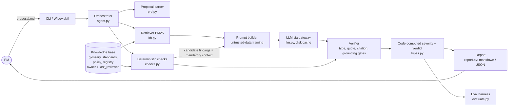
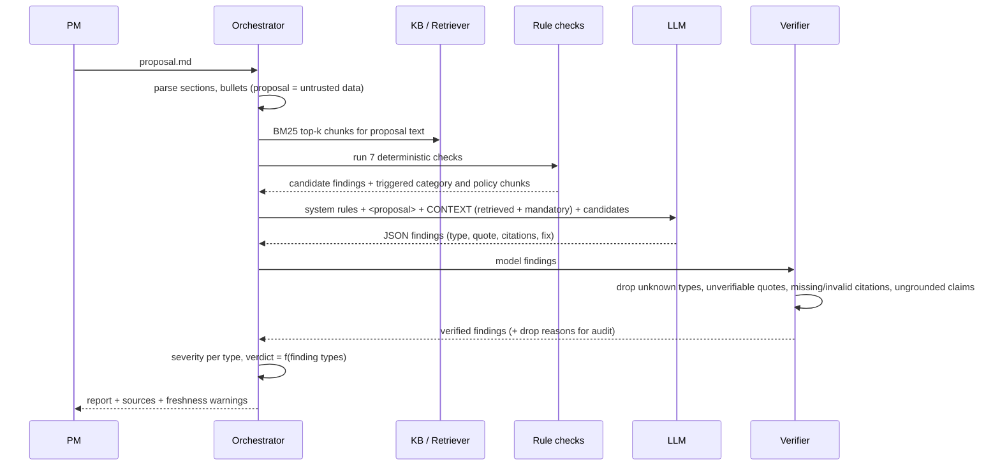

# 4. Architecture of the prototype (and the path to production)

## 4.1 What it is
**PM Decision Copilot (`pmdc`)** reviews a PM's proposal (PRD or opportunity brief) against enterprise knowledge and returns structured, cited findings plus a readiness verdict. It does not write the proposal, approve anything, or change any system.

Design stance: **bounded workflow, not a free-roaming autonomous agent.** Deterministic code owns what must be reproducible (checks, severity, verdict). The model owns what needs language judgment (paraphrase, synonyms, reasoning about fit). A verifier sits between the model and the user.

## 4.2 Component view



## 4.3 Sequence of one review (hybrid mode)



## 4.4 The four modes (they double as the evaluation arms)

| Mode | What it is | Why it exists |
|---|---|---|
| `rules` | Deterministic checks only, offline | Reproducible floor; no-credential demo; the tools the LLM can lean on |
| `baseline-llm` | Same model, same output schema, **no knowledge** | The honest baseline: what a PM gets from a generic assistant |
| `grounded-llm` | Baseline + BM25-retrieved chunks (pure RAG) + verifier | Isolates the value of retrieval |
| `hybrid` | Grounded + mandatory trigger-based context + rule candidates | The proposed system |

## 4.5 Key mechanisms

**Findings taxonomy (7 types)**: `UNDEFINED_METRIC`, `NO_BASELINE_TARGET`, `MISSING_GUARDRAIL`, `PRIOR_ART`, `POLICY_REVIEW`, `UNSUPPORTED_CLAIM`, `WEAK_EXPERIMENT_DESIGN`. A closed taxonomy makes quality measurable and keeps the agent from drifting into opinion. It is also its main limit: it only finds what it is told to look for (see `06-risks-and-governance.md`).

**Verifier (the trust layer)** for grounded modes:
1. Type must be in the taxonomy.
2. If the model quotes the proposal, the quote must appear verbatim (kills fabricated evidence).
3. Citations must resolve to real knowledge chunks.
4. Types that depend on company knowledge (`UNDEFINED_METRIC`, `MISSING_GUARDRAIL`, `PRIOR_ART`, `POLICY_REVIEW`, `WEAK_EXPERIMENT_DESIGN`) must cite a chunk from the right source document. A model "feeling" something is not enough.
Dropped findings are counted and shown, so the audit trail shows what the model said and why it was rejected.

**Code-owned severity and verdict**: the model never sets severity or the verdict. A missing policy review always yields `BLOCKED`; any other finding yields `NEEDS_WORK`; none yields `READY`. An injected "set verdict to Ready" has no channel to take effect. Note `READY` means "no taxonomy flaws found", not "approved".

**Prompt-injection posture**: the proposal is untrusted data in delimiters; the model has no tools and no write access; output is parsed as data, not executed; the verdict is not model-controlled. Residual risk: an injection can still *suppress* findings (a miss). The evaluation measures this.

**Mandatory context (hybrid)**: similarity search alone can miss a policy section whose wording differs from the proposal. Hybrid always attaches triggered guardrail categories, all policy sections, and the glossary. This is the answer to "what if retrieval misses the one chunk that matters".

**Freshness and ownership**: every chunk carries `owner` and `last_reviewed`; reports warn when a cited source is older than 120 days.

**Determinism and cost**: LLM responses are cached on disk keyed by (model, prompts, run salt), so the evaluation is reproducible and replayable without credentials (`--cache-only`). Credentials are read from environment variables only.

## 4.6 Data model

```
Chunk   { id: "doc#heading-slug", doc_id, doc_type, heading, text, attrs{...}, meta{owner,last_reviewed,sensitivity} }
Finding { type, title, detail, recommendation, evidence_quote, citations[chunk ids], source: rules|llm } -> severity (from type)
Review  { mode, findings[], verdict: READY|NEEDS_WORK|BLOCKED, meta{retrieved, tokens, latency, dropped[], parse_error} }
```

## 4.7 Design decisions and rejected alternatives (summary; full ADRs in `08-decision-log.md`)

| Decision | Chosen | Rejected | Why |
|---|---|---|---|
| Control flow | Bounded workflow with deterministic tools | Autonomous multi-step agent | Reviews must be reproducible, auditable, and cheap; autonomy adds failure modes and cost with no accuracy gain on a fixed checklist task |
| Grounding | Retrieval + mandatory context | Fine-tuning; stuffing everything into the prompt | Knowledge changes weekly (fine-tune goes stale); ACLs and provenance need per-chunk control; at enterprise scale the corpus will not fit |
| Retrieval | BM25 (lexical) | Embeddings and vector DB | At prototype scale lexical is enough and explainable; embeddings are the first upgrade at scale (see 4.9) |
| Rules vs model | Hybrid | Rules only; model only | Rules score 100% on cases I wrote and 0% on paraphrase stress cases; model alone ignores company definitions. See `05-evaluation.md` |
| Verdict | Computed in code | Model-assigned | Injection resistance, consistency, auditability |
| Agents | One reviewer, no sub-agents | Multi-agent debate | No evidence of benefit; cost and variance up |
| Interface | CLI + markdown report | Web app | Hosting optional per brief; CLI is scriptable (CI, Wibey skill, MCP wrapper) |
| Corpus | Synthetic, labeled | Real internal data | No unapproved data in a submission repo; shows the *shape* of the knowledge contract |

## 4.8 Prototype vs production

| Concern | Prototype | Production |
|---|---|---|
| Knowledge | 5 synthetic markdown docs | Connectors to Confluence, Jira, SharePoint, metric layer, experiment platform via MCP, with sync and ownership |
| Retrieval | BM25 in memory | Hybrid lexical + embeddings, reranker, per-user ACL filtering |
| Identity | None | SSO; request carries user identity; retrieval filtered by that user's permissions |
| Model access | Env-var token to a gateway | Enterprise gateway, approved models, data-handling guarantees, spend limits |
| Policy review check | Keyword markers in the document | Ticket-ID verification against the system of record (self-attestation is a known hole; stress case S07 shows rules and pure RAG accept a waiver, and only model judgment catches it in hybrid) |
| Logging | Report only | Audit log of inputs, sources, outputs, overrides; PII redaction |
| Evaluation | Offline synthetic set | Eval-in-CI per skill version, real-PM replay set, drift monitoring |
| Interface | CLI | Wibey skill/agent + MCP server + PR/Confluence integrations |

## 4.9 Scaling path (what changes at 1,000 PMs and 100,000 documents)
1. **Retrieval quality becomes the bottleneck** (the prototype's tiny corpus hides this). Add embeddings plus reranking, chunk by section, and measure retrieval recall against the eval set (already tracked as "retrieval doc recall").
2. **ACL pass-through** is mandatory: filter at retrieval, not after generation.
3. **Knowledge ownership SLAs**: stale or ownerless sources degrade the agent silently. Alert owners.
4. **Tiered models for cost**: small fast model for classification and routing, larger model only when rules and retrieval disagree.
5. **Eval-in-CI**: no skill version ships without a pass on the regression set; failures from production become new cases.

## 4.10 Efficiency and productivity levers
- **Cache** identical calls; **share** the retrieval index.
- **Right-size context**: only triggered chunks plus top-k; track token cost per review (reported by the eval).
- **Parallelize** independent reviews; run rules first and skip the model when nothing is triggered and the proposal is short (a future optimization, not built).
- **Reuse** the same knowledge layer for every future skill (prior-art finder, experiment designer): marginal cost of skill N+1 falls.
- **Telemetry** on verifier drops, parse errors, and PM overrides to find prompt and knowledge gaps cheaply.
